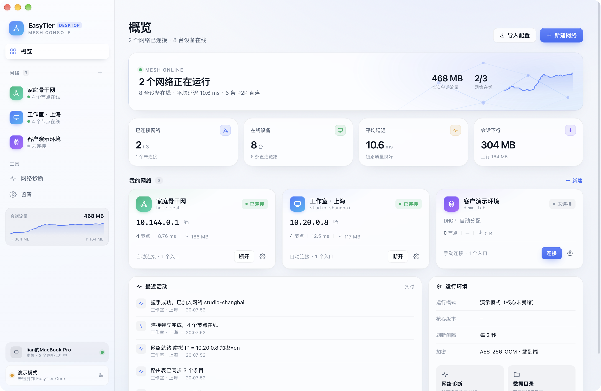

# EasyTier Desktop

一个为 macOS 重新设计的 EasyTier 图形客户端。原生 AppKit 外壳负责进程、菜单栏与系统能力，界面使用 HTML/CSS 构建，以获得更自由、更精致的视觉与交互。

> 第三方客户端，非 EasyTier 官方产品。连接真实网络需要 `easytier-core` 与 `easytier-cli`：内置核心版已包含两者，默认构建版需要另行安装。未检测到核心时自动进入演示模式。



## 功能

- **网络管理**：创建、编辑、复制、删除网络；支持公共节点、自建节点、TOML 导入三种方式。
- **多实例并行**：每个网络独立配置、独立 RPC 端口，可同时连接多张网络并快速切换。
- **连接控制**：连接 / 确认断开、异常退出提示、启动时自动连接、登录时启动、关闭窗口后驻留菜单栏。
- **节点视图**：在线设备、虚拟 IP、P2P/中继链路、延迟、丢包、流量、NAT 类型与版本；支持搜索、筛选、排序。
- **路由视图**：目标网段、下一跳、路径长度、代理网段与路由统计。
- **网络拓扑**：实时绘制本机与节点间的 P2P / 中继关系。
- **配置编辑**：完整暴露 EasyTier 配置项（DHCP、监听端口、MTU、加密、IPv6、延迟优先、多线程、禁用 P2P、退出节点、子网代理、VPN Portal、中继白名单等），实时生成 TOML 预览，可复制、导入与导出。
- **运行日志**：解析核心日志的级别与模块，支持级别过滤、搜索、自动滚动与一键复制。
- **网络诊断**：核心、RPC、配置、NAT、P2P 五项检查。
- **快捷开关**：网络总览可自定义显示全部八项网络选项；修改已连接网络时会重新连接。
- **界面**：浅色 / 深色 / 跟随系统，六种强调色，⌘1 / ⌘, / ⌘N / ⌘R 等快捷键。

## 系统要求

- macOS 13 或更高版本
- 默认构建 Apple Silicon（arm64）版本；如需 Intel 支持可使用 `--universal`

## 构建

```bash
cd EasyTier
./build.sh              # 生成 dist/EasyTier.app（arm64）
./build.sh --universal  # 生成 arm64 + x86_64 通用版本
./build.sh --dmg        # 额外生成 dist/EasyTier-1.0.2.dmg
```

构建仅依赖 Xcode Command Line Tools 中的 `swiftc`，无需安装 Xcode。TOML 解析器随源码打包，正常构建无需联网或安装 npm 依赖。

## 安装 EasyTier 核心

客户端会自动在以下位置查找 `easytier-core` / `easytier-cli`：

- Homebrew：`/opt/homebrew/bin`、`/usr/local/bin`
- `~/.cargo/bin`
- `/Applications/EasyTier.app/Contents/MacOS`
- 应用包内 `Contents/Resources/bin`

也可以把两个二进制放入 `EasyTier.app/Contents/Resources/bin/`，或在「设置 → 核心路径」中手动选择。核心可从 [EasyTier Releases](https://github.com/EasyTier/EasyTier/releases) 获取。

## 数据位置

```
~/Library/Application Support/EasyTier Desktop/
├── state.json                 # 网络列表与偏好（权限 600）
└── instances/<profile-id>/
    ├── config.toml            # 该网络实际使用的配置（权限 600）
    └── core.log               # 核心输出日志
```

## 权限说明

创建 TUN 网卡需要管理员权限。开启「以管理员权限运行」后，软件启动时请求一次授权，由本次运行的辅助进程负责启动和停止核心；退出软件后辅助进程结束，不保存密码，也不安装常驻服务。如果启动时取消授权，连接时可以重试。关闭管理员权限则以当前用户运行，适用于 `no_tun` 等场景。真实管理员授权和异常退出行为仍需在目标 Mac 上验证。

## 说明

- 应用使用 ad-hoc 签名，首次打开如被 Gatekeeper 拦截，可在「系统设置 → 隐私与安全性」中选择「仍要打开」。
- 演示模式下的网络、节点与流量均为本地模拟数据，不会产生任何网络连接。
- 菜单栏图标可快速查看各网络状态并连接 / 断开。

## 目录结构

```
EasyTier/
├── Sources/          Swift 原生外壳（窗口、WebView 桥接、核心进程、菜单栏）
├── ui/               界面（index.html / styles.css / app.js / bridge.js）
├── Resources/        Info.plist 与图标
├── build.sh          构建脚本
└── dist/             构建产物
```


## 回归验证

```bash
./scripts/test.sh             # JavaScript 回归、Swift 类型检查、模拟核心启停及日志测试
./scripts/test.sh --webkit    # 另在真实 WKWebView 中检查焦点、输入、状态和日志滚动
./scripts/test-real-core.sh /绝对路径/easytier-core /绝对路径/easytier-cli
```

测试脚本需要 Node.js、Python 3 和 Swift 编译器。真实核心测试使用临时配置、无 TUN 模式、空节点及监听列表，并禁用 STUN 和 UPnP；只通过本机 RPC 验证启停，不连接实际业务网络。`--check-config` 及真实 CLI 格式已在 EasyTier 2.6.4 验证。

- 管理员授权可以等待用户操作；取消停止时保留实例，退出应用也会等待所有核心确认停止。
- 导入配置保留原始 TOML，未编辑的字段、空节点列表、监听绑定、中继白名单和 VPN 设置都会保留；仅本地 RPC 端口按实例重新分配。导出的注释和排版会重新生成。
- 修改导入配置的监听端口或 IPv6 选项会按界面规则重新生成监听地址。
- 可通过 `ET_DATA_DIR=/临时目录` 隔离应用状态，供调试使用，不影响默认数据目录。
- `Sources/CoreRuntime.swift`、`Shell.swift`、`LogReader.swift` 分别负责进程生命周期、命令输出及增量日志；`ui/config.js` 负责 TOML 导入、合并和生成。
- TOML 依赖及许可证见 `ui/vendor/README.md`；重建它使用 `scripts/vendor-toml.sh`。

## 打包内置核心（Apple Silicon）

默认构建不包含 EasyTier 核心。若需制作无需另行下载核心的 arm64 版本：

```bash
./scripts/fetch-core.sh             # 下载并校验 EasyTier 2.6.4 官方发布包
./build.sh --bundle-core --dmg      # 输出内置核心的 App 和 EasyTier-1.0.2-bundled.dmg
```

应用会从包内 `Contents/Resources/bin` 查找核心与 CLI；已手动设置的核心路径仍优先。源码与许可信息见 [EasyTier v2.6.4](https://github.com/EasyTier/EasyTier/tree/v2.6.4)，许可证随打包的核心一起提供。内置核心不会自动授予 TUN 管理员权限。
